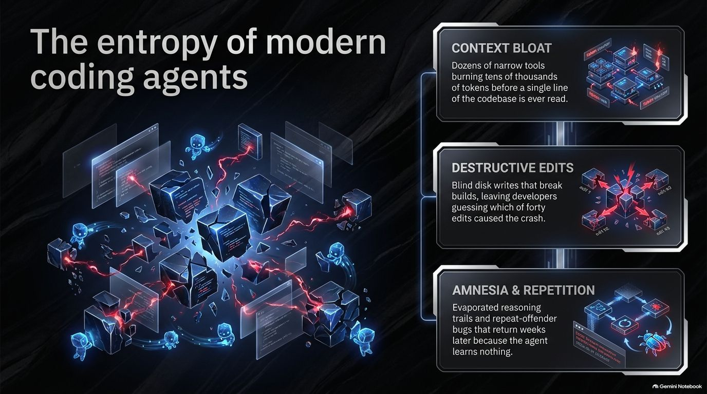
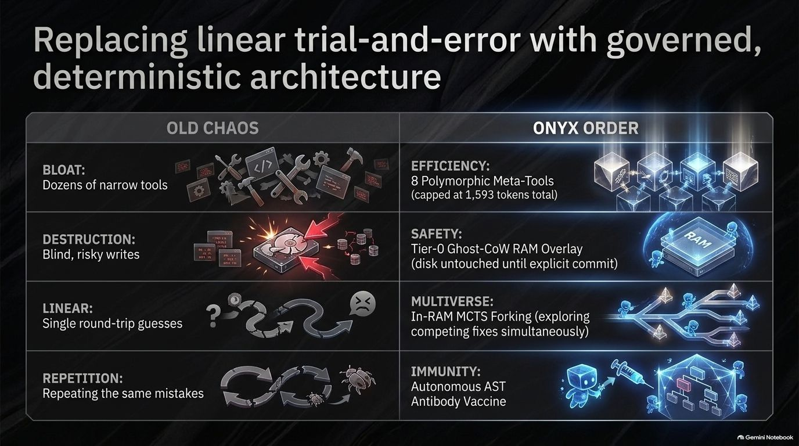
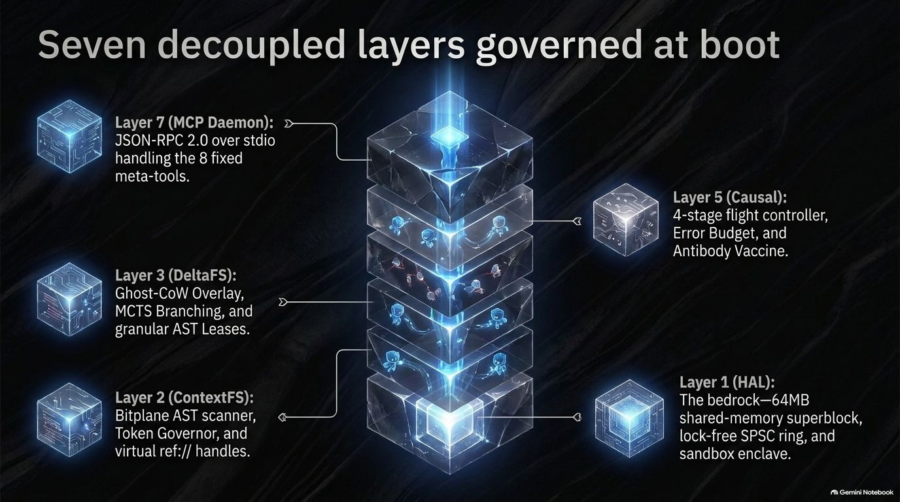
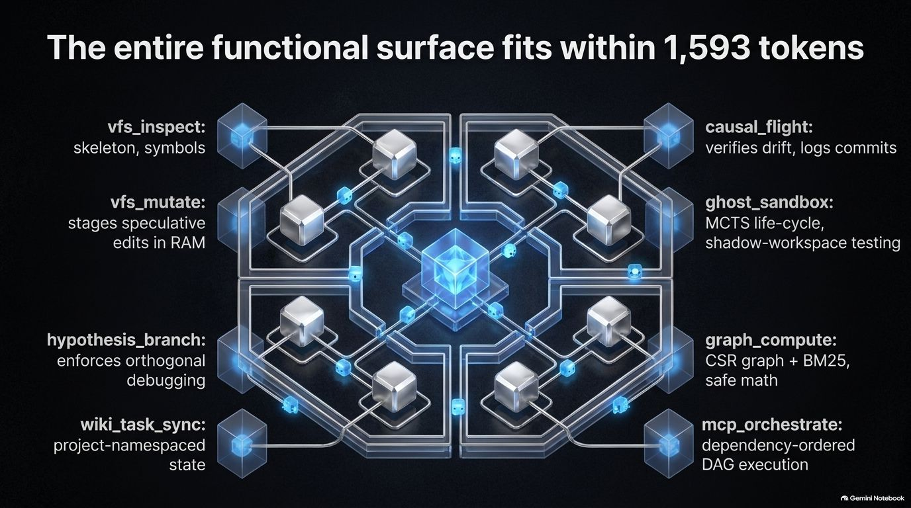
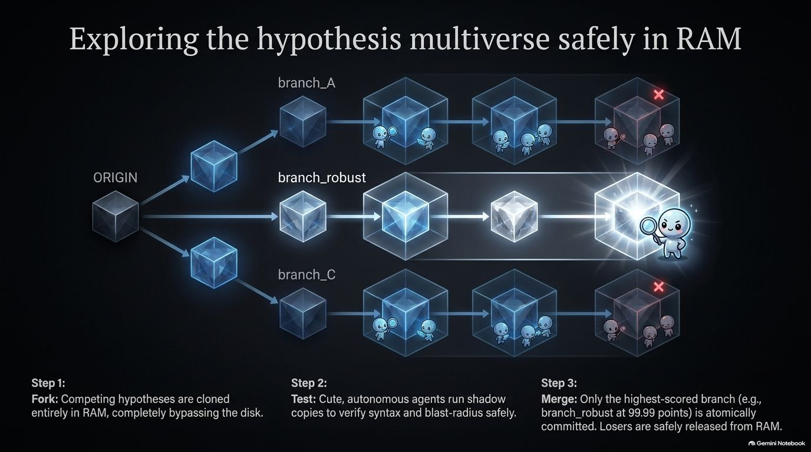
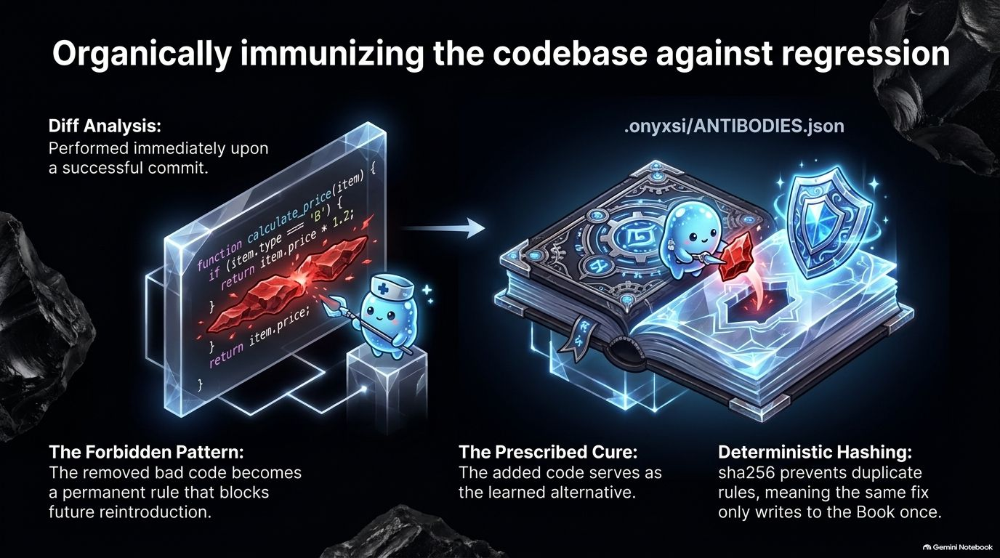
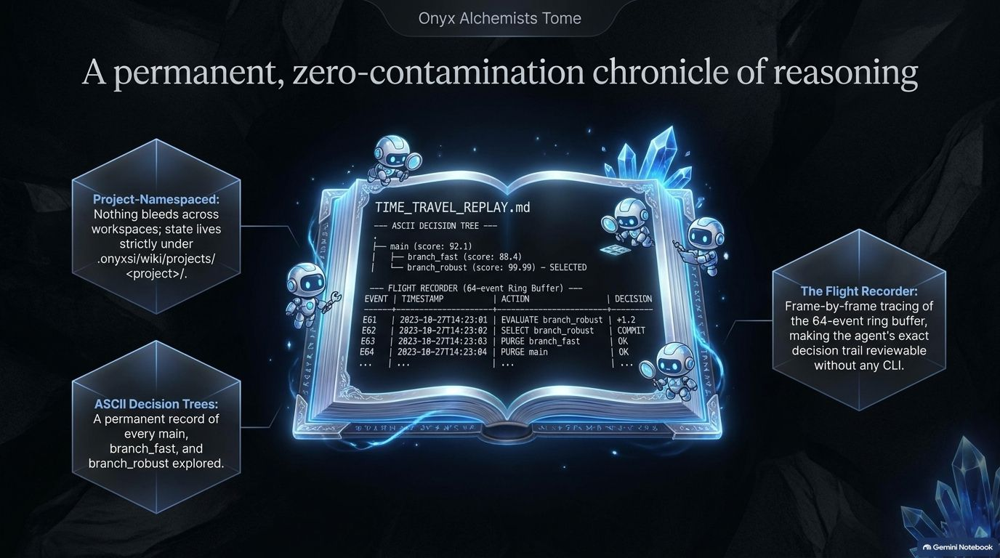
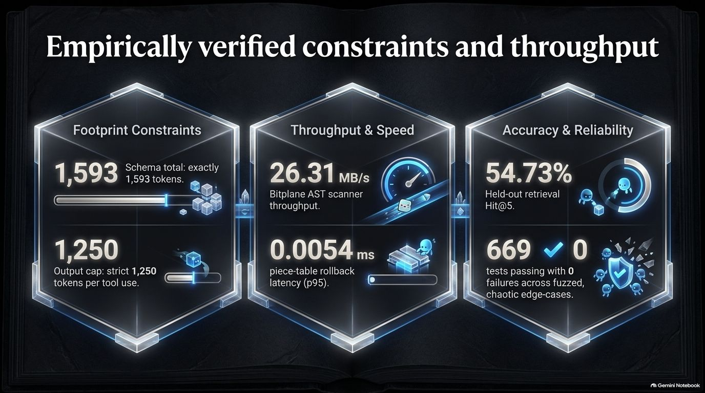
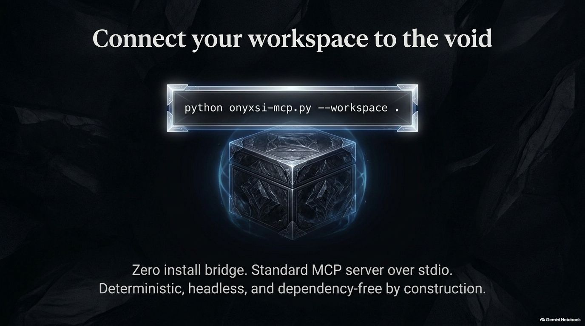

<div align="center">


# ⚡ OnyxSi (Onyx-Si)
### Pure Headless Zero-Dependency Autonomous Agent Kernel, ContextFS & Causal Execution Box

</div>

<div align="center">


**100% Python Standard Library · 100% Headless · Strict Token Budget · Crash-Safe Writes**

---

[](https://www.python.org/)
[](pyproject.toml)
[](pyproject.toml)
[](#-verification--empirical-metrics)
[](LICENSE)
<br>
[](#-verification--empirical-metrics)
[](src/onyxsi/auditor.py)
[](src/onyxsi/gateway/_meta_specs.py)
[](#-verification--empirical-metrics)
[](#-architecture)
<br>
[](#-connect-to-antigravity-opencode--mcp-clients)
[](#-connect-to-antigravity-opencode--mcp-clients)
[](#-connect-to-antigravity-opencode--mcp-clients)
[](#-architecture)

<br>

[**Why OnyxSi**](#-why-onyxsi-exists) • [**Connect MCP**](#-connect-to-antigravity-opencode--mcp-clients) • [**Live Transcript**](#-live-mcp-transcript-verified) • [**8 Meta-Tools**](#-the-fixed-8-meta-tool-surface) • [**Architecture**](#-architecture) • [**Benchmarks**](#-verification--empirical-metrics) • [**Installation**](#-installation)

</div>

---

> [!IMPORTANT]
> **Zero external dependencies by design.** An AST auditor (`src/onyxsi/auditor.py`) scans the codebase at boot and rejects banned third-party imports and UI packages. The latest audit checked **45 files with 0 violations**. OnyxSi needs no `pip install` step, compiles no native extensions, and runs without a GUI. It communicates over stdio using JSON-RPC 2.0 and persists state to Markdown and JSON files.

---

<a id="-why-onyxsi-exists"></a>
## 🎯 Why OnyxSi Exists

| ⚠️ The Problem in Modern Coding Agents | ⚡ The OnyxSi Solution |
| :---: | :---: |
| **Context window bloat.** Dozens of narrow MCP tools burn tens of thousands of tokens before the model has read a single line of the codebase. | **8 polymorphic meta-tools, 1,593 tokens total.** The whole tool surface is smaller than a typical system prompt. Output is folded into retrievable `ref://` handles above 1,250 tokens. |
| **Destructive edits.** An agent writes a file, the build breaks, and nobody knows which of forty edits caused it. | **Tier-0 Ghost-CoW overlay.** Every mutation lands in a zero-copy piece table in RAM. Disk is touched only after a syntax gate, a blast-radius test run, and an explicit commit. |
| **Linear trial and error.** One hypothesis at a time, each attempt a full round-trip through the model. | **In-RAM MCTS forking.** Several competing fixes are explored simultaneously in RAM, scored against real test runs, and the winner is the only one that reaches disk. |
| **Repeat-offender bugs.** The same mistake is re-introduced three weeks later because nobody wrote it down. | **Autonomous AST antibody vaccine.** Every commit is diffed against its own pre-image; the defective pattern that was removed becomes a permanent rule that blocks the reintroduction. |
| **Cross-project contamination.** Two repos on one machine share task IDs, progress state, and learned rules. | **Project-namespaced storage.** Task state and antibody rules live under `.onyxsi/wiki/projects/<project>/`, so nothing bleeds across workspaces. |
| **Lost reasoning.** The agent's decision trail evaporates when the session ends. | **Time-Travel Chronicle.** The branch tree and frame-by-frame event log write directly to `TIME_TRAVEL_REPLAY.md`, readable anytime without extra tools. |

<br>

### 🎬 The Architectural Narrative

<div align="center">



</div>

> **Figure 1: The Entropy of Modern Coding Agents**  
> Coding agents commonly struggle with three structural issues:
> 1. **Context Bloat:** Dozens of micro-tools consume thousands of prompt tokens on definitions alone before reading a single line of code.
> 2. **Destructive Edits:** Unbuffered disk writes corrupt working trees during multi-step edits, leaving broken builds behind.
> 3. **Amnesia & Repetition:** Without cross-session memory, fixed bugs recur weeks later because reasoning trails disappear when sessions close.

<br>

<div align="center">



</div>

> **Figure 2: Replacing Linear Trial-and-Error with Governed Architecture**  
> OnyxSi replaces speculative guesswork with deterministic, bounded execution:
> - **Efficiency:** Eight polymorphic meta-tools capped at 1,593 tokens total, eliminating tool catalog bloat.
> - **Safety:** A Tier-0 Ghost-CoW overlay buffers mutations in RAM; files touch disk only after passing syntax and blast-radius checks.
> - **Multiverse:** In-memory MCTS forking tests competing fixes in parallel rather than guessing one attempt at a time.
> - **Immunity:** AST antibody memory turns fixed bugs into permanent anti-patterns right after a commit lands.

<br>

<div align="center">



</div>

> **Figure 3: Seven Decoupled Layers Governed at Boot**  
> The runtime divides into seven layers. Before startup, an AST compliance auditor scans all 45 source files to confirm zero banned imports or UI packages:
> - **Layer 7 (MCP Daemon):** Headless JSON-RPC 2.0 engine over stdio, serving eight meta-tools with zero web server dependencies.
> - **Layers 4 & 5 (Gateway & Causal):** GBNF grammar checks, token folding, four-stage flight tracking, and a three-strike error budget.
> - **Layers 2 & 3 (ContextFS & DeltaFS):** Bitplane AST scanner, token governor, memoryview piece table, and in-memory branch leases.
> - **Layer 1 (HAL):** 64MB shared-memory superblock, lock-free SPSC telemetry ring, and process sandboxing.

<br>

### 🧩 Subsystem Architecture & Capability Matrix

| 🛠️ Fixed 8 Meta-Tool Surface | 🌲 In-RAM MCTS Multiverse Forking |
| :---: | :---: |
|  |  |
| **Functional surface capped at 1,593 tokens**<br>• `vfs_inspect` & `vfs_mutate`: Zero-copy AST inspection and RAM-buffered edits<br>• `hypothesis_branch` & `ghost_sandbox`: Ephemeral shadow execution<br>• `causal_flight` & `wiki_task_sync`: Trajectory verification and task state<br>• `graph_compute` & `mcp_orchestrate`: Deterministic ALU & DAG pipelines | **Test competing fixes in parallel in RAM**<br>• **Fork:** Clones candidate fixes in memory with zero disk I/O<br>• **Test:** Runs syntax gates and blast-radius tests in isolated shadow copies<br>• **Merge:** Commits only the highest-scoring branch to disk and drops failed attempts cleanly |

| 🛡️ Autonomous AST Antibody Vaccine | ⏱️ Time-Travel Chronicle & Flight Recorder |
| :---: | :---: |
|  |  |
| **Automatic regression prevention from commit diffs**<br>• **Diff Analysis:** Evaluates changed code lines on every successful commit<br>• **Forbidden Pattern:** The removed bug becomes an active AST anti-pattern<br>• **Prescribed Cure:** The replacement code becomes the recommended fix<br>• **Deterministic Hashing:** SHA-256 keys prevent duplicate rule entries | **Verifiable reasoning trace across sessions**<br>• **Project Namespaced:** Task state isolates under `.onyxsi/wiki/`<br>• **Decision Trees:** Records every branch evaluated during an edit<br>• **Ring Buffer Log:** Tracks relative timestamps, actions, and test results in `TIME_TRAVEL_REPLAY.md` |

| 📊 Empirically Verified Invariants | 🔌 Zero-Install Connection & Stdio Bridge |
| :---: | :---: |
|  |  |
| **Empirically verified resource ceilings**<br>• **1,593 Tokens:** Combined schema footprint ceiling strictly maintained<br>• **1,250 Tokens:** Per-call output limit with folding into `ref://` handles<br>• **3.9 μs (0.0039 ms):** Ghost-CoW rollback latency (p95)<br>• **669 Passed Tests:** Zero failures across chaos, fuzzing, and scenario suites | **Pure Python stdlib headless orchestration**<br>• **Zero Installation:** Runs directly from checkout with `python onyxsi-mcp.py`<br>• **Standard Stdio MCP:** Connects directly to Google Antigravity, OpenCode, and Claude Desktop<br>• **Minimal Setup:** No Node.js runtime, compilers, or UI processes |

---

<a id="-connect-to-antigravity-opencode--mcp-clients"></a>
## 🔌 Connect to Antigravity, OpenCode & MCP Clients

<details>
<summary><b>🔍 Click to expand: Connection Guide & MCP Configurations (Antigravity, OpenCode, Claude Desktop)</b></summary>
<br>

OnyxSi is a standard MCP server communicating over `stdio` using JSON-RPC 2.0. It requires zero package installations and runs straight from source on both Windows and Linux.

### 1. Google Antigravity

Antigravity natively orchestrates OnyxSi via its global configuration file (`~/.gemini/config/mcp_config.json`). All 8 Meta-Tools are auto-discovered from `~/.gemini/antigravity/mcp/onyxsi/`:

**Global Configuration** (`C:\Users\<user>\.gemini\config\mcp_config.json`):

```json
{
  "mcpServers": {
    "onyxsi": {
      "command": "L:\\.Tool\\OnyxSi\\.venv\\Scripts\\python.exe",
      "args": [
        "L:\\.Tool\\OnyxSi\\onyxsi-mcp.py",
        "--workspace",
        "L:\\.Tool\\OnyxSi"
      ],
      "env": {
        "PYTHONUNBUFFERED": "1",
        "PYTHONIOENCODING": "utf-8"
      }
    }
  }
}
```

> [!TIP]
> **Pre-compiled Tool Schemas:** Tool schemas and execution instructions are stored directly under `~/.gemini/antigravity/mcp/onyxsi/` (`onyxsi_vfs_inspect.json`, `onyxsi_vfs_mutate.json`, etc.), allowing Antigravity to invoke each tool with zero catalog latency.

### 2. OpenCode v2

OpenCode **v2** reads MCP servers from `mcp.servers` (unlike v1, which read `mcp` directly). Create `opencode.jsonc` in your project root, or add the block to `~/.config/opencode/opencode.jsonc` to make it available everywhere.

**Project-scoped** (`opencode.jsonc` next to your code):

```jsonc
{
  "$schema": "https://opencode.ai/config.json",
  "mcp": {
    "servers": {
      "onyxsi": {
        "type": "local",
        "command": ["python", "/absolute/path/to/OnyxSi/onyxsi-mcp.py", "--workspace", "."],
        "timeout": { "startup": 60000, "execution": 600000 }
      }
    }
  }
}
```

**Global** (`~/.config/opencode/opencode.jsonc`): omit `--workspace` and OnyxSi targets whichever project the editor is currently in:

```jsonc
{
  "$schema": "https://opencode.ai/config.json",
  "shell": "powershell",
  "mcp": {
    "servers": {
      "onyxsi": {
        "type": "local",
        "command": [
          "python",
          "L:\\.Tool\\OnyxSi\\onyxsi-mcp.py"
        ],
        "timeout": { "startup": 60000, "execution": 600000 }
      }
    }
  }
}
```

> [!TIP]
> **Zero-install bridge.** `onyxsi-mcp.py` puts the checkout's `src/` on `sys.path`, pins stdin/stdout to UTF-8, and disables `.pyc` writing so the checkout stays pristine. `onyxsi-mcp.cmd` (Windows) and `onyxsi-mcp.sh` (Linux/macOS) are thin wrappers around it. No `pip install`, no `PYTHONPATH`, no virtualenv.

### 3. Claude Desktop / Cursor / Windsurf / VS Code

Add to your client's `claude_desktop_config.json` or MCP settings:

```jsonc
{
  "mcpServers": {
    "onyxsi": {
      "command": "python",
      "args": [
        "/absolute/path/to/OnyxSi/onyxsi-mcp.py",
        "--workspace",
        "/absolute/path/to/your/project"
      ]
    }
  }
}
```

### 4. Direct Terminal Verification

Verify the server protocol initialization directly over terminal pipes:

```bash
echo '{"jsonrpc":"2.0","id":1,"method":"initialize","params":{"protocolVersion":"2024-11-05","capabilities":{},"clientInfo":{"name":"probe","version":"1.0"}}}' \
  | python onyxsi-mcp.py --workspace .
```

<details>
<summary><b>🔍 Click to expand: Full CLI reference</b></summary>

```
onyxsi --workspace DIR          # serve DIR over JSON-RPC stdio
           --project-name NAME   # namespace for the task wiki + antibody store
                                 # (default: the workspace folder name)
           --no-pre-flight-gate  # allow vfs_mutate without causal_flight pre_flight
           --telemetry-out PATH  # append per-tool JSONL telemetry on shutdown
           --max-index-files N   # cap on indexed .py files          (default: 5000)
           --max-index-mb MB     # per-file size cap                 (default: 2.0)
           --max-index-total-mb MB # total index byte budget         (default: 128.0)
           --max-shadow-mb MB    # temp shadow copy cap for tests    (default: 512.0)
```

</details>

</details>

---

<a id="-live-mcp-transcript-verified"></a>
## 🧪 Live MCP Transcript (Verified)

<details>
<summary><b>🔍 Click to expand: In-RAM MCTS Loop Walkthrough & Execution Trace</b></summary>
<br>

The transcript below was captured directly from an interactive session over stdio JSON-RPC. It exercises the full MCTS loop: forking competing hypotheses in RAM, testing each in an isolated shadow copy of the workspace, scoring the results, merging the winner, and writing the final state to disk.

**Step 1: Open a session and stage the baseline fix**

```json
→ {"jsonrpc":"2.0","id":1,"method":"tools/call","params":{"name":"ghost_sandbox","arguments":{"cmd":"begin"}}}
← {"status":"ok","mode":"ghost_sandbox_active","session_id":"074a5c0c"}

→ {"jsonrpc":"2.0","id":2,"method":"tools/call","params":{"name":"ghost_sandbox","arguments":{"cmd":"fork","branch_id":"branch_fast","hypothesis":"rename the helper, keep the body"}}}
← {"status":"ok","branch_id":"branch_fast","branches":[
     {"branch_id":"main","parent":null,"hypothesis":"","active":false,"modified_files":1,"score":null},
     {"branch_id":"branch_fast","parent":"main","hypothesis":"rename the helper, keep the body","active":true,"modified_files":1,"score":null}]}
```

**Step 2: Test each branch in an isolated shadow workspace**

```json
→ {"jsonrpc":"2.0","id":3,"method":"tools/call","params":{"name":"ghost_sandbox","arguments":{"cmd":"switch_branch","branch_id":"branch_fast"}}}
→ {"jsonrpc":"2.0","id":4,"method":"tools/call","params":{"name":"ghost_sandbox","arguments":{"cmd":"test","command":"python demo_mcts/check.py","timeout_s":60}}}
← {"status":"ok","test_result":"FAILED","mode":"shadow-workspace","exit_code":1,"duration_ms":30.9,
   "shadow_files":132,"staged_files":1,
   "stderr_tail":"AssertionError: add(2, 3) returned -1, expected 5\n",
   "enforcement":{"workspace":"path-prefix; the command ran in a temp copy, the real workspace was not written",
                  "syscall":"none","network":"not isolated"}}

→ {"jsonrpc":"2.0","id":5,"method":"tools/call","params":{"name":"ghost_sandbox","arguments":{"cmd":"switch_branch","branch_id":"branch_robust"}}}
→ {"jsonrpc":"2.0","id":6,"method":"tools/call","params":{"name":"ghost_sandbox","arguments":{"cmd":"test","command":"python demo_mcts/check.py","timeout_s":60}}}
← {"status":"ok","test_result":"PASSED","exit_code":0,"stdout_tail":"PASS: add(2, 3) == 5\n"}
```

**Step 3: Score, merge the winner, and commit it**

```json
→ {"jsonrpc":"2.0","id":7,"method":"tools/call","params":{"name":"ghost_sandbox","arguments":{
     "cmd":"merge_best",
     "scores":[{"branch_id":"main","passed_tests":0,"total_tests":1},
               {"branch_id":"branch_fast","passed_tests":0,"total_tests":1},
               {"branch_id":"branch_robust","passed_tests":1,"total_tests":1}]}}}
← {"status":"ok","winner":"branch_robust","score":99.9914,"scores":[
     {"branch_id":"main","score":0},
     {"branch_id":"branch_fast","score":-0.0024},
     {"branch_id":"branch_robust","score":99.9914}],
   "hint":"The winning branch is active and still in RAM; cmd=commit writes it to disk."}

→ {"jsonrpc":"2.0","id":8,"method":"tools/call","params":{"name":"ghost_sandbox","arguments":{"cmd":"commit"}}}
← {"status":"ok","committed_files":{"L:\\.Tool\\OnyxSi\\demo_mcts\\calc.py":118}}
```

The file on disk after the commit:

```python
def add(a, b):
    if not isinstance(a, (int, float)):
        raise TypeError('a must be a number')
    return a + b
```

**Step 4: Write the decision trail to disk**

```json
→ {"jsonrpc":"2.0","id":9,"method":"tools/call","params":{"name":"wiki_task_sync","arguments":{
     "task_id":"TASK-001","op":"replay","project_name":"OnyxSi",
     "branches":[{"branch_id":"main","hypothesis":"baseline as found on disk","score":0},
                 {"branch_id":"branch_fast","parent":"main","hypothesis":"rename the helper, keep the body","score":-0.0024},
                 {"branch_id":"branch_robust","parent":"main","hypothesis":"fix the operator, guard the type","score":99.9914}]}}}
← {"status":"ok","path":"L:\\.Tool\\OnyxSi\\.onyxsi\\wiki\\projects\\OnyxSi\\tasks\\TASK-001\\TIME_TRAVEL_REPLAY.md"}
```

Which produced `TIME_TRAVEL_REPLAY.md`:

```text
# Time-Travel Replay: TASK-001

**Project:** `OnyxSi` | **Generated:** 2026-10-20T11:59:00Z | **Frames:** 0 | **Branches:** 3

## 1. ASCII Decision & State Branch Tree

```text
main  [score=0.00]  — baseline as found on disk
├── branch_fast  [score=-0.00]  — rename the helper, keep the body
└── branch_robust  [score=99.99]  — fix the operator, guard the type
```
```

> [!NOTE]
> **The scoring formula:** `score = (passed / max(1, total)) * 100 - drift * 50 - min(10, diff_bytes / 10000)`. The test pass ratio carries the most weight. Drift reflects trajectory divergence measured by the causal engine, and the diff penalty is capped at 10 points so a larger correct patch is not penalized over a smaller incorrect one. If omitted, `drift` defaults to the live trajectory drift.

</details>

---

<a id="-the-fixed-8-meta-tool-surface"></a>
## 🧰 The Fixed 8 Meta-Tool Surface

<details>
<summary><b>🔍 Click to expand: 8 Meta-Tools Specifications, Verified Payloads & Architectural Deep-Dives</b></summary>
<br>

OnyxSi exposes eight polymorphic meta-tools with a combined schema size of 1,593 tokens. The router enforces an 1,800-token hard ceiling at construction and refuses to start if it is exceeded.

| Meta-Tool | Operations | Purpose |
| :--- | :--- | :--- |
| `vfs_inspect` | `tree`, `skeleton`, `read`, `symbols`, `grammar`, `resolve` | Read-only inspection: directory maps, AST outlines, line ranges, exact/prefix symbol lookup, GBNF grammar export, `ref://` handle resolution. |
| `vfs_mutate` | `replace_file`, `replace_node`, `insert_after`, `slice_patch`, `merge_patches` | Stages a speculative edit in the in-RAM Ghost overlay. Disk stays untouched until commit. `merge_patches` applies non-overlapping agent patches and unifies imports. |
| `ghost_sandbox` | `begin`, `mutate`, `test`, `commit`, `discard`, `fork`, `switch_branch`, `list_branches`, `merge_best` | Ghost overlay lifecycle plus the in-RAM MCTS branch machinery. `test` runs blast-radius selection or an explicit command inside a shadow copy of the workspace. |
| `causal_flight` | `pre_flight`, `ghost_burn`, `verify`, `commit`, `reflect`, `bisect` | The 4-stage flight controller: declares blast radius, checks drift (<15%), re-parses staged files, logs the commit, resets the 3-strike budget, and binary-searches checkpoints for the culprit. |
| `hypothesis_branch` | `register`, `falsify`, `select` | Enforces orthogonal debugging hypotheses (Jaccard ≤ 0.70) with mandatory falsification probes, distilling failures into one-line negative lessons. |
| `wiki_task_sync` | `init`, `update`, `handoff`, `replay` | Project-namespaced task state: spec, progress JSON/Markdown, execution log, `AGENT_HANDOFF.md`, and the `TIME_TRAVEL_REPLAY.md` chronicle. |
| `graph_compute` | `engine=bm25` · `engine=blast_radius` · `engine=alu` (`type=eval`\|`matrix_matmul`\|`matrix_inv`\|`ieee754`) | Deterministic local compute: CSR+BM25 search, impacted-test selection, safe math evaluation, matrix algebra, IEEE-754 inspection. No LLM involved. |
| `mcp_orchestrate` | `steps[]` with `depends_on` | Runs meta-tools as one dependency-ordered DAG in a single round-trip; later steps read earlier output via `$prev.output` or `$<step>.output`. |

Every argument is validated against the declared JSON schema **before** a handler runs: unknown properties are rejected, enums are enforced, and a tool without a bound handler fails closed rather than echoing its input.

### 🔬 Verified Meta-Tool & Resource Schema Reference

The examples below show tested payloads from stdio JSON-RPC and Google Antigravity MCP sessions:

<details>
<summary><b>📋 Click to expand: Verified Payloads & Empirical Responses for all 8 Meta-Tools</b></summary>

#### 1. `vfs_inspect`: AST Outline & Read-Only Navigation
- **Operations (`action`):** `tree` · `skeleton` · `read` · `symbols` · `grammar` · `resolve`
- **Example Call:**
  ```json
  {"name": "vfs_inspect", "arguments": {"action": "tree", "target": "src/onyxsi", "max_tokens": 500}}
  ```
- **Verified Output:** Compact hierarchical tree representation with token budget folding.

#### 2. `vfs_mutate`: In-RAM Speculative Edits (Ghost-CoW)
- **Operations (`op`):** `slice_patch` · `replace_file` · `replace_node` · `insert_after` · `merge_patches`
- **Example Call:**
  ```json
  {"name": "vfs_mutate", "arguments": {"op": "slice_patch", "path": "src/onyxsi/contracts.py", "start_line": 1, "end_line": 1, "code": "# contracts\n"}}
  ```
- **Verified Output:** In-RAM piece-table diff and staged hash; disk remains completely untouched until committed.

#### 3. `ghost_sandbox`: In-RAM MCTS Branching & Isolated Shadow Tests
- **Operations (`cmd`):** `begin` · `fork` · `test` · `switch_branch` · `list_branches` · `merge_best` · `commit` · `discard`
- **Example Call:**
  ```json
  {"name": "ghost_sandbox", "arguments": {"cmd": "begin"}}
  ```
- **Verified Output:** Active session ID (`session_id`) and branch table for branch isolation.

#### 4. `causal_flight`: 4-Stage Trajectory & Drift Guard
- **Stages (`stage`):** `pre_flight` · `ghost_burn` · `verify` · `commit` · `reflect` · `bisect`
- **Example Call:**
  ```json
  {"name": "causal_flight", "arguments": {"stage": "pre_flight", "blast_radius": ["src/onyxsi/contracts.py"], "hypothesis": "Inspect contracts"}}
  ```
- **Verified Output:** Stage authorization, drift index check (<15%), and error budget counter verification.

#### 5. `hypothesis_branch`: Orthogonal Debugging Exploration
- **Modes (`mode`):** `register` · `falsify` · `select`
- **Example Call:**
  ```json
  {
    "name": "hypothesis_branch",
    "arguments": {
      "mode": "register",
      "branches": [
        {"branch_id": "H1", "statement": "Verify causal tracking", "target_nodes": ["contracts.py"], "probe": "probe_test"}
      ]
    }
  }
  ```
- **Verified Output:** Hypothesis registered with Jaccard divergence check (≤ 0.70) against competing hypotheses.

#### 6. `wiki_task_sync`: Project-Namespaced Task & Replay Engine
- **Operations (`op`):** `init` · `update` · `handoff` · `replay`
- **Example Call:**
  ```json
  {"name": "wiki_task_sync", "arguments": {"op": "init", "task_id": "TASK-ANTIGRAVITY", "spec": "Verify Antigravity MCP"}}
  ```
- **Verified Output:** Isolated state persistence initialized under `.onyxsi/wiki/projects/<project>/tasks/`.

#### 7. `graph_compute`: Deterministic Local Compute ALU & Graph Engine
- **Engines (`engine`):** `alu` (`type=eval`|`matrix_matmul`|`matrix_inv`|`ieee754`) · `bm25` (`query`) · `blast_radius` (`changed_files`)
- **Example Call:**
  ```json
  {"name": "graph_compute", "arguments": {"engine": "alu", "type": "eval", "query": "2 + 2"}}
  ```
- **Verified Output:** Deterministic evaluation result (`4`) computed in-process with 0 LLM latency.

#### 8. `mcp_orchestrate`: Zero-Round-Trip Meta-Tool DAG Pipeline
- **Parameters:** `steps[]` with `id`, `tool`, `arguments`, and optional `depends_on`
- **Example Call:**
  ```json
  {
    "name": "mcp_orchestrate",
    "arguments": {
      "steps": [
        {"id": "s1", "tool": "graph_compute", "arguments": {"engine": "alu", "type": "eval", "query": "40 + 2"}}
      ]
    }
  }
  ```
- **Verified Output:** Multi-step pipeline output resolved and merged in a single transport cycle.

---

#### 📦 Live MCP Resources
OnyxSi exposes direct state and compliance resources over the MCP protocol:
- `onyxsi://schema`: JSON-RPC 2.0 schema for all eight meta-tools with exact token counts (1,593 tokens).
- `onyxsi://audit`: AST auditor report verifying zero third-party dependencies and zero UI packages.

</details>

<details>
<summary><b>🔍 Click to expand: The three headline capabilities in depth</b></summary>

### 1. In-RAM MCTS speculative forking

```text
                     ┌───────────────┐
                     │     main      │  ← the baseline every branch forks from
                     └───────┬───────┘
            ┌────────────────┼────────────────┐
            ▼                ▼                ▼
     ┌────────────┐  ┌──────────────┐  ┌────────────┐
     │ branch_fast│  │ branch_robust│  │ branch_alt │
     │ score 41.0 │  │ score 99.99  │  │ score 62.5 │
     └────────────┘  └──────────────┘  └────────────┘
            │                │
            └──── fork ──────┘
                  ▼
          ┌──────────────┐
          │ merge_best   │  → winner stays active in RAM, losers are released
          └──────────────┘
                  ▼
             ghost_commit()  → one atomic write to disk
```

Each branch owns its own piece-table documents and tombstones. Forking clones the source branch in RAM so mutations cannot corrupt parent branches. Switching branches requires only a pointer rebind with no copying, write-back, or state loss.

### 2. Autonomous AST antibody auto-vaccine

```text
commit ──► diff(baseline, fixed)
              │
              ├─ removed line  ──► forbidden_pattern   (blocks the reintroduction)
              └─ added line    ──► prescribed_alternative   (the cure)
              │
              └─► AB-<sha256(file, pattern)[:10] ──► .onyxsi/wiki/projects/<p>/ANTIBODIES.json
```

The antibody generates only after a successful commit. A rolled-back write leaves no rules behind for unmerged code. The generated `antibody_id` uses a deterministic SHA-256 hash, so committing an identical fix never creates duplicate entries.

### 3. Time-Travel Chronicle

`wiki_task_sync op=replay` renders two sections: an ASCII decision tree of all explored branches and a table logging the 64-event ring buffer (Frame, Relative Time, Branch, Action, Target, Outcome). Writes are atomic.

</details>

</details>

---

<a id="-architecture"></a>
## 🏛️ Architecture & System Topology

<details>
<summary><b>🔍 Click to expand: Subsystem ER Diagram, 7 Decoupled Layers & Repository Topology</b></summary>
<br>

<div align="center">


<br>
<em>Figure 4: OnyxSi Kernel Data Structure Entity-Relationship & Subsystem Topology</em>

</div>

<br>

```text
┌───────────────────────────────────────────────────────────────────────────┐
│                        Layer 7 — MCP Daemon (server.py)                   │
│              JSON-RPC 2.0 over stdio · 8 fixed meta-tools                │
└──────────────────────────────────────┬────────────────────────────────────┘
                                       │
┌──────────────────────────────────────┴────────────────────────────────────┐
│                    Layer 4 — Headless Gateway & Shields                   │
│   Fixed 8 Meta-Tools · Grammar Shield · Stream Folder · Policy Gate      │
└───────────────┬───────────────────────┬───────────────────────┬────────────┘
                │                       │                       │
┌───────────────┴──────────────┐ ┌──────┴──────────────┐ ┌──────┴──────────────┐
│      Layer 2 — ContextFS     │ │   Layer 3 — DeltaFS  │ │   Layer 5 — Causal   │
│  Bitplane AST · Piece Table  │ │  Ghost-CoW Overlay   │ │  4-Stage Flight     │
│  Token Governor · ref://     │ │  MCTS Branching      │ │  Error Budget · WAL  │
│  Virtual Handles             │ │  AST Lease & Merger  │ │  Antibody Vaccine   │
└───────────────┬──────────────┘ └──────┬──────────────┘ └──────┬──────────────┘
                │                       │                       │
┌───────────────┴───────────────────────┴───────────────────────┴────────────┐
│                  Layer 6 — Knowledge, Graph & Deterministic ALU            │
│     Project-Namespaced Task Wiki · CSR Graph + BM25 · Blast-Radius Runner   │
└──────────────────────────────────────┬─────────────────────────────────────┘
                                       │
┌──────────────────────────────────────┴────────────────────────────────────┐
│          Layer 1 — HAL: SHM Superblock · SPSC Ring · Radix Trie · Proc     │
└──────────────────────────────────────┬─────────────────────────────────────┘
                                       │
┌──────────────────────────────────────┴────────────────────────────────────┐
│            Layer 0 — Contracts & Error Codes (E0001 – E9004)               │
└───────────────────────────────────────────────────────────────────────────┘
```

The architecture consists of seven layers, verified at startup by the AST compliance auditor:

| Layer | Module | Responsibility |
| :--- | :--- | :--- |
| **0** | `onyxsi.contracts` | `OnyxError` / `OnyxErrorCode` (E0001–E9004) and the shared data contracts. |
| **1** | `onyxsi.hal` | 64MB shared-memory superblock (POSIX `/dev/shm` + Windows tagged mmap), lock-free SPSC ring buffer, flat `array('I')` radix trie, process supervisor, syscall guard, sandbox enclave, non-blocking cross-process wakeup, telemetry ring. |
| **2** | `onyxsi.contextfs` | SWAR/DBP bitplane AST scanner and skeleton pruner, memoryview piece table with nano-checkpoints, token ceiling governor, `ref://` virtual handle registry, workspace scanner. |
| **3** | `onyxsi.deltafs` | Tier-0 Ghost-CoW overlay (now with MCTS branches), 4KB sparse page delta map with reflink + disk spillover to `.onyxsi/spill/`, granular AST node leases, conflict-free bottom-up patch merger. |
| **4** | `onyxsi.gateway` | Fixed 8 meta-tool router, deterministic JSON auto-repair shield, GBNF grammar exporter, macro pipeline fusion, stream folder, policy gate with secret masking. |
| **5** | `onyxsi.causal` | 4-stage trajectory enforcer, 3-strike error budget, micro-WAL flight recorder, orthogonal hypothesis engine, in-RAM causal bisect, antibody memory with the auto-vaccine. |
| **6** | `onyxsi.knowledge` | Project-namespaced task wiki, vectorless CSR graph + tuned BM25, blast-radius differential test runner, safe compute ALU. |
| **7** | `onyxsi.server` | The headless JSON-RPC 2.0 daemon and the MCP bridge. |

<details>
<summary><b>🔍 Click to expand: Repository topology</b></summary>

```text
OnyxSi/
├── onyxsi-mcp.py                  # Zero-install UTF-8 MCP bridge
├── onyxsi-mcp.sh                  # Linux/macOS launcher wrapper
├── onyxsi-mcp.cmd                 # Windows batch launcher wrapper
├── opencode.jsonc                 # OpenCode MCP server definition
├── pyproject.toml                 # Build config (zero dependencies, MIT)
├── src/onyxsi/
│   ├── __init__.py                # Root facade exposing Layers 0-6
│   ├── __main__.py                # python -m onyxsi entry point
│   ├── server.py                  # JSON-RPC 2.0 stdio daemon
│   ├── contracts.py               # OnyxError, OnyxErrorCode, path-segment sanitizer
│   ├── auditor.py                 # AST zero-dependency & zero-UI auditor
│   ├── hal/                       # Layer 1
│   ├── contextfs/                 # Layer 2
│   ├── deltafs/                   # Layer 3
│   ├── gateway/                   # Layer 4
│   ├── causal/                    # Layer 5
│   └── knowledge/                 # Layer 6
├── tests/
│   ├── run_tests.py               # Zero-dependency stdlib test runner
│   ├── test_killer_features.py    # Namespacing / MCTS / vaccine / replay / dispatch
│   ├── normal/                    # 45 spec-verification modules
│   ├── street/                    # 11 chaos, fuzz and concurrency modules
│   └── character/                 # 10 end-to-end scenario modules
├── benchmarks/
│   ├── bench_onyxsi.py            # Automated benchmark harness
│   ├── recall_eval.py             # Labelled-corpus retrieval evaluator
│   ├── BENCHMARKS.md              # Measured performance report
│   └── results_v1.0.json          # Telemetry snapshot
└── md/                            # Architectural blueprints & phase specs
```

</details>

### On-disk state

```text
<workspace>/.onyxsi/
├── leases/                                          # Cross-process AST leases
├── spill/                                           # CoW workspace disk spillover
├── FLIGHT_LOG.md                                    # Stage 4 commit trail
├── CRASH_REPRO.md                                   # Written on a daemon crash
└── wiki/
    ├── ANTIBODIES.json                              # Legacy store (still read)
    └── projects/
        └── <project>/
            ├── ANTIBODIES.json                      # Project-scoped vaccine
            └── tasks/
                └── TASK-<ID>/
                    ├── TASK_SPEC.md
                    ├── PROGRESS.json
                    ├── PROGRESS.md
                    ├── EXECUTION_LOG.md
                    ├── AGENT_HANDOFF.md
                    └── TIME_TRAVEL_REPLAY.md
```

</details>

---

<a id="-verification--empirical-metrics"></a>
## 📊 Verification & Empirical Metrics

<details>
<summary><b>🔍 Click to expand: Empirical Measurements, Invariants & Dual-OS Benchmarks</b></summary>
<br>

> [!NOTE]
> **Benchmark sources:** Every metric below is drawn directly from `benchmarks/results_v1.0.json`, generated by running `python benchmarks/bench_onyxsi.py` on the test environment described below.

| Telemetry Metric | Measured | Ceiling | Status |
| :--- | :---: | :---: | :---: |
| **Meta-tool schema footprint** | **1,593 tokens** | ≤ 1,800 | **PASS** |
| **Output token ceiling** | **1,250 tokens** | ≤ 1,250 | **PASS** |
| **Virtual handle resolvability (`ref://`)** | **resolvable** | true | **PASS** |
| **Bitplane AST scanner throughput** | **35.98 MB/s** | ≥ 20.0 MB/s | **PASS** |
| **Piece-table rollback latency (p95)** | **0.0039 ms** | ≤ 1.0 ms | **PASS** |
| **Ghost overlay discard latency (p95, 25 files)** | **3.26 ms** | ≤ 5.0 ms | **PASS** |
| **Blast-radius test selection (p95, 500 tests)** | **0.625 ms** | ≤ 5.0 ms | **PASS** |
| **Causal bisect search latency (p95, 64 steps)** | **0.0105 ms** | ≤ 1,000 ms | **PASS** |
| **Antibody check latency (p95)** | **0.0051 ms** | ≤ 5.0 ms | **PASS** |
| **CSR + BM25 hybrid search (p95, 5,000 nodes)** | **5.70 ms** | ≤ 50.0 ms | **PASS** |
| **JSON-RPC stdio round-trip (p95)** | **0.52 ms** | ≤ 50.0 ms | **PASS** |
| **Held-out retrieval Hit@5 (150 queries)** | **54.67%** | ≥ 50.0% | **PASS** |
| **Held-out retrieval Recall@5 (150 queries)** | **39.11%** | ≥ 30.0% | **PASS** |

**Measurement environment:** Windows 11 · AMD64 · 8 logical CPUs · Python 3.15.0rc2 · `benchmarks/results_v1.0.json` (Updated 2026-10-21).

### ⚡ Multi-Runtime & Dual-OS Benchmark Comparison

Comparison across deployment environments tested on the same physical hardware:

| Invariant / Telemetry Metric | Windows 11 (Py 3.12.10) | Windows 11 (Py 3.15.0rc2) | WSL2 Ubuntu (Py 3.14.4) | Target Ceiling | Status |
| :--- | :---: | :---: | :---: | :---: | :---: |
| **Bitplane AST Scanner Throughput** | 26.54 MB/s | **35.98 MB/s** | **43.29 MB/s** | $\ge$ 20.0 MB/s | **PASS** |
| **Piece-Table Rollback (p95)** | 0.0054 ms | **0.0039 ms** | **0.0031 ms** | $\le$ 1.0 ms | **PASS** |
| **Ghost Overlay Discard (p95)** | 3.27 ms | **3.26 ms** | **0.33 ms** | $\le$ 5.0 ms | **PASS** |
| **Blast-Radius Test Selection (p95)** | 0.631 ms | **0.625 ms** | **0.472 ms** | $\le$ 5.0 ms | **PASS** |
| **Causal Bisect Latency (p95)** | 0.0122 ms | **0.0105 ms** | **0.0089 ms** | $\le$ 1,000 ms | **PASS** |
| **Antibody Vaccine Check (p95)** | 0.0049 ms | **0.0051 ms** | **0.0045 ms** | $\le$ 5.0 ms | **PASS** |
| **CSR Graph + BM25 Search (p95)** | 6.47 ms | **5.70 ms** | **5.94 ms** | $\le$ 50.0 ms | **PASS** |
| **JSON-RPC stdio Round-Trip (p95)** | 0.56 ms | **0.52 ms** | **0.12 ms** | $\le$ 50.0 ms | **PASS** |
| **Full Benchmark Suite Wall Clock** | 1.76 s | **1.47 s** | **1.74 s** | — | **ALL PASS** |

> [!IMPORTANT]
> **Measurement details:** The AST skeleton pruner reports the measured ratio (skeleton ÷ source = **0.683**, roughly 32% smaller than original source files across the benchmark corpus) rather than theoretical estimates. Retrieval evaluations use held-out test data without docstring leakage. While indexing docstrings directly yields an artificial 100% Hit@5, held-out retrieval reflects actual search performance.

### Test suite

```bash
# Full suite under pytest
python -m pytest -v

# Same suite, zero third-party dependencies
python tests/run_tests.py

# Reproduce the benchmark table
python benchmarks/bench_onyxsi.py
```

| Suite | Scope |
| :--- | :--- |
| `tests/normal/` (45 modules) | 1:1 specification verification across every layer: superblock, SPSC ring, bitplane AST, piece table, ghost overlay, leases, merger, router, grammar shield, trajectory, error budget, hypothesis engine, bisect, antibody, task wiki, CSR+BM25, blast runner, ALU, daemon, MCP protocol. |
| `tests/street/` (11 modules) | Fuzzing: unclosed JSON brackets, circular DAG pipelines, lease races, concurrent writers, simulated power cuts during atomic writes, boundary conditions. |
| `tests/character/` (10 modules) | End-to-end personas: amnesiac handoffs, rapid single-byte patching, deep recursion bombs, hostile string manipulation, multi-agent swarms. |
| `tests/test_killer_features.py` | The v1.0.0-PROD features: project namespacing, Time-Travel Chronicle, MCTS forking and merge, the auto-vaccine, and JSON-RPC dispatch. |

**Result: 669 tests passing, 0 failures.** Verified on Windows (Python 3.12.10, Python 3.15.0rc2) and Ubuntu WSL2 (Python 3.14.4 / pytest 9.0.2).

</details>

---

<a id="-installation"></a>
## 🚀 Installation & Quick Start

**Prerequisites:** Python 3.11 or newer. Nothing else.

```bash
# Option 1 (zero install): run straight from the checkout
python onyxsi-mcp.py --workspace /path/to/your/project

# Option 2 (install as an editable package):
pip install -e .
onyxsi --workspace /path/to/your/project
```

```bash
# Linux / macOS
./onyxsi-mcp.sh --workspace /path/to/your/project

# Windows
onyxsi-mcp.cmd --workspace C:\path\to\your\project
```

---

<a id="-support"></a>
## ☕ Support & Sponsor

If OnyxSi is useful in your agent workflows or saves context tokens, consider supporting continued development:

<div align="center">

<a href="https://ko-fi.com/xtanthaix" target="_blank">
  
</a>

</div>

---

<a id="-license"></a>
## 📜 License

MIT license. See [LICENSE](LICENSE). Copyright © 2026 xTanTHaix.

<div align="center">

**Deterministic, headless, and dependency-free by construction.**

</div>
